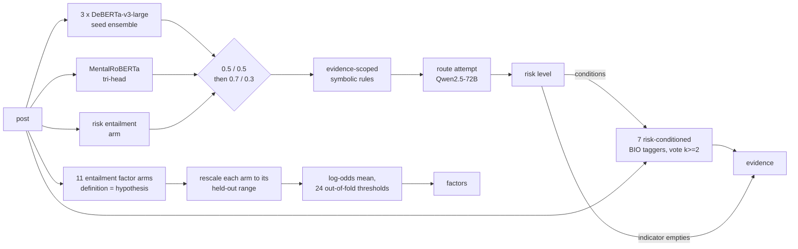

# Bag of Tricks or Bag of Myths?

**Reducing Modeling Complexity with Task Knowledge in Explainable Suicide Risk Assessment**

Shlok Shelat, Shrey Salvi, Souvik Roy, Manas Gaur, Amit Sheth

Team **NIDHI**, first place in the 3rd IEEE BigData Cup: Explainable Suicide Risk Detection on Social Media (2026).

[Paper (arXiv:2609.07766)](https://arxiv.org/abs/2609.07766) · [Pipeline](docs/PIPELINE.md) · [Audit map](docs/AUDIT_MAP.md) · [Code map](docs/CODE_MAP.md) · [Data and ethics](docs/DATA_AND_ETHICS.md)

---

## What this is

Given one Reddit post, the system returns three things: a 4-level suicide risk
level, the exact words in the post that justify it, and which of 24 clinical
risk and protective factors the post shows.

The paper behind it is an audit. We tested 31 pre-specified techniques from the
standard NLP playbook (bigger models, synthetic data, reweighted losses,
ensembling, threshold tuning, LLM prompting, and more) in roughly 300 controlled
runs on author-disjoint partitions. Five held. Each of the five exploits
something this task already supplies: written label definitions, steep label
imbalance, an annotator-marked evidence clause, error diversity across
architectures, and one weak risk class. The submitted system, TRIDENT, keeps
only those, plus one repair that is not a technique at all: thresholds fitted on
single-fold predictions sit in the wrong place once fold models are averaged,
and correcting that (deployment-consistent calibration) was the largest single
gain to the finished system.

This repository holds the complete code: the system, the experiments behind
every row of the paper's audit, and the guards that make the submission
rebuild exactly.

## Results

| Component | Metric | Blind leaderboard set |
|---|---|---|
| Risk level | weighted F1 | 0.8203 |
| Evidence spans | phrase F1 (per post) | 0.7953 |
| Clinical factors | macro F1 over 24 labels | 0.7045 |
| **Composite** | 0.4 R + 0.3 E + 0.3 F | **0.7781** |

Final evaluation by the organizers: model performance 77.06 (30%), report
quality 93 (30%), innovation 84 (40%), total 84.62, first among the 31 teams
that submitted final solutions.

## The system in one picture



Details, with every weight and threshold and the reason for it:
[docs/PIPELINE.md](docs/PIPELINE.md).

## Quick start

**Run the tests** (CPU, seconds, no data needed):

```bash
pip install -r requirements-cpu.txt
make test
```

**Rebuild the submitted predictions exactly** (CPU, about a minute, no GPU, no
weights). This needs the gated, text-bearing files described below, because
they contain the test posts and evidence spans:

```bash
python tools/verify_bundle.py      # must print READY
make reproduce                     # prints FULL MATCH
```

`make reproduce` writes a file byte-identical to the submitted one
(MD5 `927debd984bd49fb0b43c691c64bdae4`).

**Score your own posts** (one H100, about a day, needs the trained weights):
see [docs/PIPELINE.md#running-on-unseen-data](docs/PIPELINE.md#running-on-unseen-data).

## What is public, and what is gated

This repository contains **no post text**. That is a deliberate rule, and the
reproduction is designed around it.

| | Where | Size |
|---|---|---|
| All code, tests, Slurm job specs | this repository | |
| Numeric model outputs (68 files: factor scores, risk probabilities) | `artifacts/` here | 2.7 MB |
| Test posts, training set, evidence spans, submitted predictions (34 files) | gated, see [artifacts/MANIFEST.md](artifacts/MANIFEST.md) | 1.7 MB |
| 67 trained checkpoints (62 run directories + 5 MentalRoBERTa folds) | [`ShlokShlok123/nidhi-weights`](https://huggingface.co/ShlokShlok123/nidhi-weights) (gated) | 86.6 GB |

The posts are real crisis posts from a clinical research dataset. Anyone with
legitimate access to the competition data can obtain the gated files; every
file is listed with its SHA-256 in the manifest, so a received copy can be
checked byte for byte. See [docs/DATA_AND_ETHICS.md](docs/DATA_AND_ETHICS.md).

## Repository layout

```
src/                 all Python: build path, inference, training, experiments
src/friend_pipeline/ the MentalRoBERTa tri-head (second risk member, friendfac arm)
scripts/             Slurm job specifications for the cluster runs
tests/               scorer and alignment tests (run in CI)
artifacts/           public numeric model outputs + MANIFEST.md
tools/               bundle verification and packing
docs/                pipeline, audit map, code map, data and ethics
```

The build path is ten modules. Everything else is either inference for new
data or one of the experiments the paper reports; [docs/CODE_MAP.md](docs/CODE_MAP.md)
lists every file with its purpose.

## Responsible use

This is research code for an offline shared task. It orders a queue; it does
not make clinical judgments. Its outputs are not diagnoses or risk assessments
in the clinical sense and must not trigger any action concerning a person
without a human reading the post. A tool like this could be misused to surveil
people who have not asked for attention; that the posts are public does not
make that acceptable. Please read [docs/DATA_AND_ETHICS.md](docs/DATA_AND_ETHICS.md)
before using any part of it.

If you or someone you know is struggling, please contact local emergency
services or a crisis line in your country.

## Citation

```bibtex
@article{shelat2026bagoftricks,
  title   = {Bag of Tricks or Bag of Myths? Reducing Modeling Complexity with
             Task Knowledge in Explainable Suicide Risk Assessment},
  author  = {Shelat, Shlok and Salvi, Shrey and Roy, Souvik and Gaur, Manas and
             Sheth, Amit},
  journal = {arXiv preprint arXiv:2609.07766},
  year    = {2026}
}
```

## License

Code: MIT (see `LICENSE`). The license covers the code only; it grants no rights
to the competition dataset, which remains under the organizers' terms.
